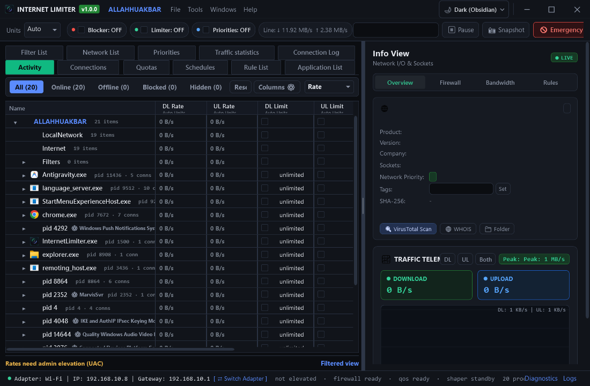
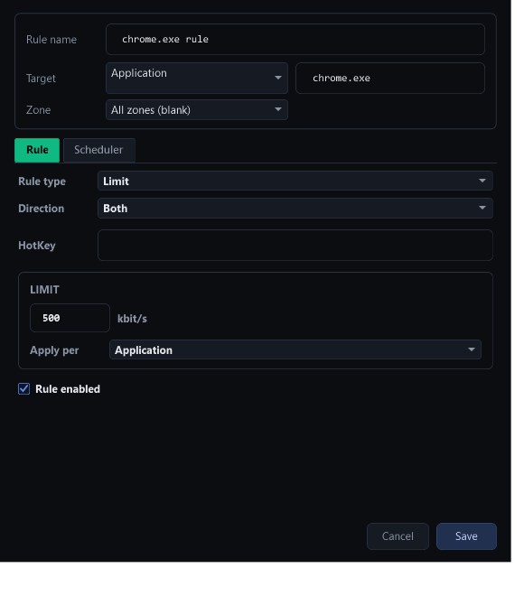
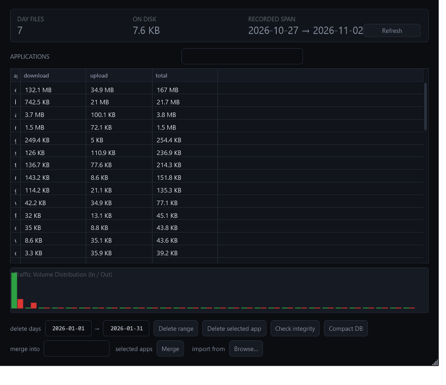
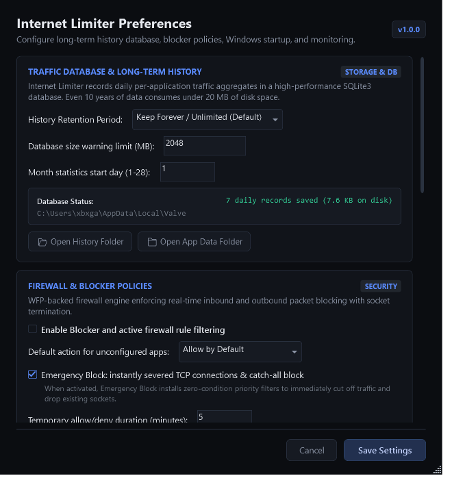

# Internet Limiter 🚀

<div align="center">


### High-Performance Real-Time Windows Network Traffic Controller & Bandwidth Shaper
*The modern, lightweight, open-source NetLimiter alternative engineered for precision and speed.*

[-0078D6?style=for-the-badge&logo=windows&logoColor=white)](https://github.com/letmese/InternetLimiter)
[](https://github.com/letmese/InternetLimiter)
[](https://github.com/letmese/InternetLimiter)
[](https://github.com/letmese/InternetLimiter)
[](LICENSE)

</div>

---

## 📖 Overview

**Internet Limiter** is a professional-grade Windows network traffic shaping, application monitoring, and firewall system. Built from the ground up to overcome the latency and heavy footprint of legacy network limiters, Internet Limiter provides exact, kernel-level traffic throttling, application-aware connection blocking, time-series usage statistics, and real-time bandwidth visualization.

Unlike standalone utilities that require high-privilege driver reloads on every launch, Internet Limiter features a **24/7 background Windows Service (`InternetLimiterService`)**. The lightweight GUI client connects instantly via local Named Pipe IPC in **under 200ms**, with zero UAC elevation prompts during daily operation.

---

## ✨ Key Features

### ⚡ 1. High-Precision Bandwidth Shaping
* **Dual-Directional Limits**: Enforce strict Download and Upload rate caps independently for any application, socket, or zone.
* **Hierarchical Token Bucket**: Zero packet dropping on throttled flows; intelligent token replenishment ensures ultra-smooth streams without jitter.
* **Prioritization Queues**: Assign applications to **Critical**, **High**, **Normal**, **Low**, or **Background** priority pools with automatic bandwidth yielding during congestion.

### 🛡️ 2. Integrated Kernel Blocker & Firewall
* **Stateful Flow Filtering**: Inspect and filter TCP, UDP, ICMP, and IPv4/IPv6 packets at the Windows Filtering Platform (WFP) and WinDivert kernel layer.
* **3-State Protection**: Toggle any process between **Allow**, **Block**, or **Ask** (quarantine flows until explicitly authorized).
* **Granular Rule Engine**: Craft rules based on Process Name/Path, Remote IP ranges (CIDR), Remote Ports, Protocols, and Domain wildcards.

### 🚀 3. Instant Client-Service Architecture
* **Background Windows Service**: `InternetLimiterService` runs 24/7 under LocalSystem, maintaining network limits and usage logs even when the UI window is closed.
* **Sub-200ms GUI Launch**: The desktop UI connects to the running service via authenticated local named pipes (`\\.\pipe\ValveServicePipe`) without UAC prompts.
* **Crash-Resilient Engine**: Windows SCM auto-recovery automatically restarts the shaper service within 5 seconds in the event of an unexpected fault.

### 📊 4. Real-Time Telemetry & Historical Analytics
* **Live Vector Traffic Graphs**: 180-sample moving vector graphs with instantaneous bit/byte format scaling.
* **SQLite Time-Series Storage**: Durable, transactional SQLite storage recording hourly, daily, and monthly usage per process.
* **Quota & Schedule System**: Configure daily or monthly bandwidth quotas with automatic policy enforcement (throttle, block, or alert) and time-of-day active windows.
* **GeoIP & Reverse DNS**: Real-time country flag resolution and background asynchronous hostname lookups.

---

## 📸 Screenshots

<div align="center">

### Main Traffic Controller & Activity Monitor


### Granular Filter Rule & Priority Editor


### Long-Term Usage Analytics & Stats Manager


### Client-Service & Network Configuration


</div>

---

## 📥 Installation

### Method 1: Standalone Windows Setup (Recommended)
Download and run **`InternetLimiter_Setup.exe`**.
* Installs files into `C:\Program Files\Internet Limiter`
* Registers and starts `InternetLimiterService` in Windows Service Control Manager
* Creates Desktop and Start Menu shortcuts
* Registers in Windows **Settings > Apps > Installed Apps** with complete uninstallation support.

#### Silent / Unattended Installation
For automated or headless deployments, run:
```powershell
InternetLimiter_Setup.exe /S
```

### Method 2: Portable Mode
If you prefer running portable without installing the background service, simply run `InternetLimiter.exe`. The application will request administrator elevation to initialize local drivers directly.

---

## 🛠️ Command-Line Interface (CLI)

`InternetLimiter.exe` includes built-in service lifecycle commands:

| Command | Description |
| :--- | :--- |
| `InternetLimiter.exe` | Launches the interactive desktop graphical interface |
| `InternetLimiter.exe --service` | Runs the headless kernel shaping engine under Windows SCM |
| `InternetLimiter.exe --install-service` | Registers and starts `InternetLimiterService` |
| `InternetLimiter.exe --uninstall-service`| Stops and deletes `InternetLimiterService` from SCM |
| `InternetLimiter.exe --probe-service` | Queries IPC status and reports active service metrics |
| `InternetLimiter.exe --uninstall` | Performs full application uninstallation and shortcut cleanup |

---

## 🏗️ Building from Source

### Prerequisites
* Windows 10/11 x64
* [.NET 8 SDK](https://dotnet.microsoft.com/download/dotnet/8.0)
* PowerShell 5.1+

### Build Steps
```powershell
# 1. Clone repository
git clone https://github.com/letmese/InternetLimiter.git
cd InternetLimiter

# 2. Build Release binaries
dotnet build Valve.csproj -c Release

# 3. Run 83/83 End-to-End Automated Tests
dotnet run --project e2e_tests/Valve.E2ETests.csproj -c Release

# 4. Compile Standalone Installer (InternetLimiter_Setup.exe)
powershell -ExecutionPolicy Bypass -File installer/build_setup.ps1
```

---

## 👨‍💻 Author & Maintainer

Designed and maintained by **letmese**.

* **GitHub:** [@letmese](https://github.com/letmese)
* **Portfolio:** [letmese Portfolio](https://github.com/letmese/letmese-portfolio)
* **Inquiries:** Open for desktop systems and network software contracts worldwide.

---

## 📄 License
This project is licensed under the [MIT License](LICENSE).
